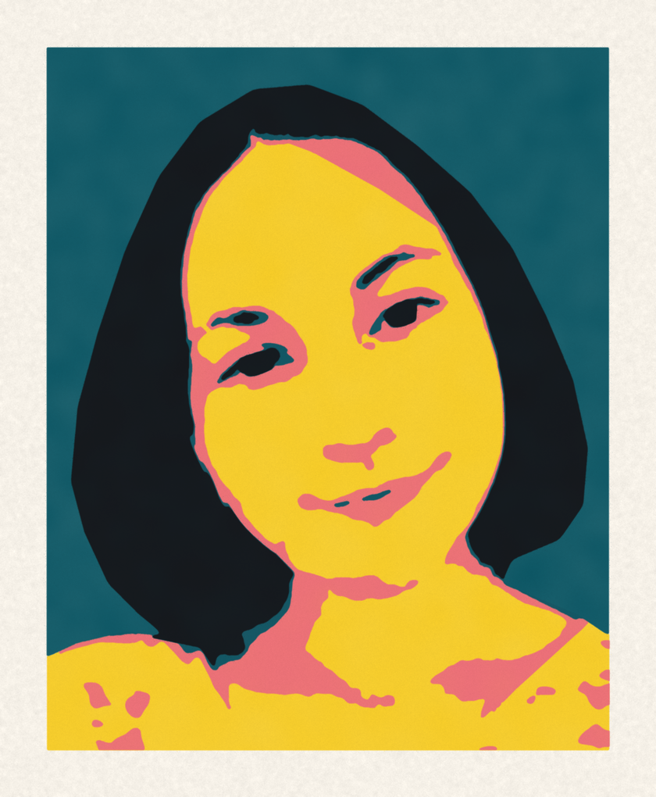

# Schablone

Erzeugt aus einem Foto einen Satz aus vier Sprayschablonen: Tonwerttrennung, Stege, Vektorkonturen, USDZ-Modelle, technische Zeichnung und eine Simulation des gesprühten Bilds.



*Maria, Simulation aus den Schnittkonturen*

Live: <https://helmutqualtinger.github.io/Schablone/> (GitHub Pages aus `docs/`, `docs/index.html` ist eine Kopie von `ausgabe/Maria_simulation.html`)

## Schablonensatz

Platte 420 × 510 × 1 mm (PETG), Motivfeld 360 × 450 mm, kleinste Materialbreite 2 mm. Gesprüht wird von hell nach dunkel:

| Platte | Farbe | Nähe | Datei |
|---|---|---|---|
| S1 | Sonnengelb | RAL 1018 | `*_S1_gelb.usdz` |
| S2 | Korallrosa | RAL 3014 | `*_S2_rosa.usdz` |
| S3 | Petrol | RAL 5020 | `*_S3_petrol.usdz` |
| S4 | Tiefschwarz | RAL 9005 | `*_S4_schwarz.usdz` |

## Erzeugen

Aus dem Projektordner, `MOTIV` ist `bb` (Standard), `maria` oder `carl`:

```sh
export MOTIV=maria PYTHONPATH=src
python3 src/check.py /tmp/satz.pkl
python3 src/export.py /tmp/satz.pkl
```

Benötigt `opencv-python`, `numpy`, `shapely` ab 2.1, `reportlab` sowie `usdcat` und `usdzip`.

## Webseite für eigene Fotos

```sh
uv run web/app.py
```

startet einen lokalen Server auf <http://127.0.0.1:8000>. Dort lässt sich ein Foto hochladen. Der Server schneidet es mittig auf 4:5 zu, stellt das Hauptmotiv per GrabCut frei (abschaltbar) und trennt die Tonwerte nach einstellbaren Flächenanteilen (`src/separation_auto.py`). Danach berechnet er Stege und Konturen mit `src/stencil_geom.py` und zeigt den Ablauf als Simulation wie bei Maria. Eine Berechnung dauert etwa 30 bis 60 Sekunden. Danach stehen zwei Downloads bereit: das Vierfarbbild als PNG (6 px/mm) und eine STL-Datei mit allen vier Schablonen im 2 × 2-Raster für ein Druckbett von 250 × 250 mm, 0,5 mm dick, Maßstab 23,7 % (`src/druck.py`). Fotos werden nicht gespeichert, die Druckdateien bleiben 30 Minuten in einem temporären Ordner (`$TMPDIR/schablone_web`), auch über einen Neustart des Servers hinweg. Abhängigkeiten stehen in `pyproject.toml`, die genauen Versionen in `uv.lock`. `uv run` legt beim ersten Aufruf `.venv/` an, OpenCV kommt dabei aus der Gruppe `lokal`.

### Container

```sh
docker build -t schablone .
docker run --rm -p 8000:8000 schablone
```

Alpine-Image mit zwei Stufen, rund 180 MB. Die Build-Stufe installiert die Python-Pakete mit `uv sync --frozen` aus `uv.lock` und baut OpenCV nur mit den Modulen core, imgproc, imgcodecs und photo, statisch gelinkt in `cv2` (erster Build etwa 5 Minuten). Für musl gibt es kein OpenCV-Wheel, und Alpines `py3-opencv` brächte Qt, GTK und ffmpeg mit (rund 880 MB). Das Laufzeit-Image enthält nur Python, das venv und `libstdc++`, läuft als unprivilegierter Benutzer mit Gunicorn und hat einen Healthcheck. `.dockerignore` hält `quelle/` mit den privaten Fotos aus dem Build-Kontext.

## Aufbau

| Pfad | Inhalt |
|---|---|
| `quelle/` | Ausgangsfotos (`Maria.png` und `Carl2.JPG` sind privat und nicht im Repository) |
| `src/motiv.py` | Motivauswahl, Dateipräfix und Texte |
| `src/separation.py`, `src/separation_maria.py`, `src/separation_carl.py` | Tonwerttrennung je Motiv |
| `src/stencil_geom.py` | Stege, Vektorisierung, Platten |
| `src/export.py` | USDZ, PDF, Spraybild |
| `src/separation_auto.py`, `src/simdata.py`, `src/druck.py` | automatische Trennung, Simulationsdaten, STL und Vierfarbbild für die Webseite |
| `web/app.py`, `web/static/index.html` | Flask-Backend und Seite mit Upload und Simulation |
| `ausgabe/` | Ergebnisse |

## Ausgabe

- `<Präfix>_technische_zeichnung.pdf`: Übersicht und je ein Blatt pro Platte, A3
- `<Präfix>_spraybild.png`, `<Präfix>_spraybild_motiv.png`: Simulation mit und ohne Rand
- `usdz/`: 3D-Modelle der Platten
- `<Präfix>_simulation.html`: interaktiver Ablauf vom Foto zum Spraybild
