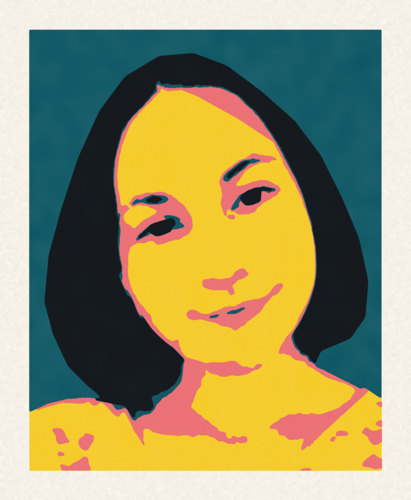

# Schablone

Erzeugt aus einem Foto einen Satz aus vier Sprayschablonen: Tonwerttrennung, Stege, Vektorkonturen, USDZ-Modelle, technische Zeichnung und eine Simulation des gesprühten Bilds.



*Maria, Simulation aus den Schnittkonturen*

Live: <https://helmutqualtinger.github.io/Schablone/> (GitHub Pages aus `docs/`, `docs/index.html` ist eine Kopie von `ausgabe/Maria_simulation.html`)

## Schablonensatz

Platte 420 × 510 × 1 mm (PETG), Motivfeld 360 × 450 mm, kleinste Materialbreite 2 mm. Gesprüht wird von hell nach dunkel:

| Platte | Farbe | Nähe | Datei |
|---|---|---|---|
| S1 | Sonnengelb | RAL 1018 | `*_S1_gelb.usdz` |
| S2 | Korallrosa | RAL 3014 | `*_S2_rosa.usdz` |
| S3 | Petrol | RAL 5020 | `*_S3_petrol.usdz` |
| S4 | Tiefschwarz | RAL 9005 | `*_S4_schwarz.usdz` |

## Erzeugen

Aus dem Projektordner, `MOTIV` ist `bb` (Standard) oder `maria`:

```sh
export MOTIV=maria PYTHONPATH=src
python3 src/check.py /tmp/satz.pkl
python3 src/export.py /tmp/satz.pkl
```

Benötigt `opencv-python`, `numpy`, `shapely` ab 2.1, `reportlab` sowie `usdcat` und `usdzip`.

## Aufbau

| Pfad | Inhalt |
|---|---|
| `quelle/` | Ausgangsfotos (`Maria.png` ist privat und nicht im Repository) |
| `src/motiv.py` | Motivauswahl, Dateipräfix und Texte |
| `src/separation.py`, `src/separation_maria.py` | Tonwerttrennung je Motiv |
| `src/stencil_geom.py` | Stege, Vektorisierung, Platten |
| `src/export.py` | USDZ, PDF, Spraybild |
| `ausgabe/` | Ergebnisse |

## Ausgabe

- `<Präfix>_technische_zeichnung.pdf`: Übersicht und je ein Blatt pro Platte, A3
- `<Präfix>_spraybild.png`, `<Präfix>_spraybild_motiv.png`: Simulation mit und ohne Rand
- `usdz/`: 3D-Modelle der Platten
- `<Präfix>_simulation.html`: interaktiver Ablauf vom Foto zum Spraybild
